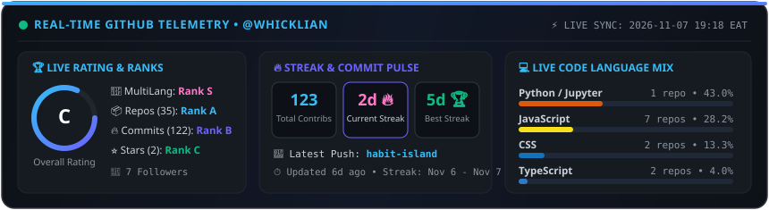

<!-- ═══════════════════════════════════════════════════════════════════ -->
<!--                     🌊  ANIMATED GRADIENT HEADER  🌊                  -->
<!-- ═══════════════════════════════════════════════════════════════════ -->

<p align="center">
  
</p>

<!-- ═══════════════════════════════════════════════════════════════════ -->
<!--                     ⌨️  ANIMATED TYPING  ⌨️                           -->
<!-- ═══════════════════════════════════════════════════════════════════ -->

<p align="center">
  <a href="https://github.com/whicklian">
    
  </a>
</p>

<!-- ═══════════════════════════════════════════════════════════════════ -->
<!--                     🌐 PORTFOLIO & QUICK NAV CALLOUT 🌐               -->
<!-- ═══════════════════════════════════════════════════════════════════ -->

<p align="center">
  <a href="https://portfolio-frontend-ecru-kappa.vercel.app/" target="_blank">
    
  </a>
  <a href="https://whicklian.vercel.app" target="_blank">
    
  </a>
  <a href="mailto:neriowhicklian@gmail.com">
    
  </a>
</p>

<!-- ═══════════════════════════════════════════════════════════════════ -->
<!--                     🏅  REAL-TIME BADGES ROW  🏅                      -->
<!-- ═══════════════════════════════════════════════════════════════════ -->

<p align="center">
  
  
  
  
  
  <a href="https://portfolio-frontend-ecru-kappa.vercel.app/" target="_blank">
    
  </a>
  
  
</p>

<br>

<!-- ═══════════════════════════════════════════════════════════════════ -->
<!--                     🧠  ABOUT ME & LIVE SYSTEM HUD  🧠                -->
<!-- ═══════════════════════════════════════════════════════════════════ -->


###   About Me

```yaml
name:        Whicklian Nerio
role:        Fullstack Developer & Data Science Track Lead
portfolio:   https://portfolio-frontend-ecru-kappa.vercel.app/
education:   BSc. Computer Science @ MMUST
community:   Google Developer Groups (GDG MMUST)
location:    Kenya 🇰🇪 (EAT / UTC+3)
focus:       Clean, scalable Python backends + delightful UIs
learning:    Cloud Native • System Design • Microservices
hobbies:     Hackathons • Open Source • Tech Meetups
motto:       "From MMUST to the World — Code, Create, Collaborate."
```

<br clear="right"/>

<!--START_SECTION:realtime_status-->
<div align="center">

| ⚡ **Live Telemetry** | 🔥 **Active / Best Streak** | 🏆 **Overall Rating** | 📊 **Last Year / Nov Velocity** |
| :---: | :---: | :---: | :---: |
| 🟢 **Synced** (`2026-11-07 19:30 EAT`) | **18 Days 🔥** *(Oct 21 - Nov 07)* | **Rank A+ (Top 8%)** *(MultiLang: S • Repos: 41)* | **1,074 Contribs** *(504+ Commits in Nov)* |

</div>
<!--END_SECTION:realtime_status-->

<p align="center">
  <a href="https://github.com/whicklian">
    
  </a>
</p>

---

<!-- ═══════════════════════════════════════════════════════════════════ -->
<!--                     🛠️  TECH STACK  🛠️                              -->
<!-- ═══════════════════════════════════════════════════════════════════ -->

<h3 align="center">🛠️  Tech Stack & Engineering Arsenal</h3>

<p align="center">
  <a href="https://skillicons.dev">
    
  </a>
</p>

<p align="center">
  
  
  
  
  
  
  
  
  
  
  
  
  
  
  
  
  
  
</p>

---

<!-- ═══════════════════════════════════════════════════════════════════ -->
<!--              🔥  STREAKS, RATING & GITHUB ANALYTICS  📊               -->
<!-- ═══════════════════════════════════════════════════════════════════ -->

<h3 align="center">📊  Real-Time GitHub Rating, Streaks & Analytics</h3>

<!-- Row 1: Rating Card (Classic) + Global Percentile Rating Card (Extended) -->
<p align="center">
  <a href="https://github.com/whicklian">
    
  </a>
  <a href="https://github.com/whicklian">
    
  </a>
</p>

<!-- Row 2: Live Streak Stats + Top Languages -->
<p align="center">
  <a href="https://github.com/whicklian">
    
  </a>
  <a href="https://github.com/whicklian">
    
  </a>
</p>

<!-- Row 3: Contribution Activity Graph & Profile Overview -->
<p align="center">
  <a href="https://github.com/whicklian">
    
  </a>
</p>

<!-- Row 4: Deep-Dive Telemetry (Productive Time, Repos by Language, Commits by Language) -->
<p align="center">
  <a href="https://github.com/whicklian">
    
  </a>
  <a href="https://github.com/whicklian">
    
  </a>
  <a href="https://github.com/whicklian">
    
  </a>
</p>

---

<!-- ═══════════════════════════════════════════════════════════════════ -->
<!--                     🏆  TROPHIES  🏆                                  -->
<!-- ═══════════════════════════════════════════════════════════════════ -->

<h3 align="center">🏆  GitHub Trophies & Achievements</h3>

<p align="center">
  <a href="https://github.com/whicklian">
    
  </a>
</p>

---

<!-- ═══════════════════════════════════════════════════════════════════ -->
<!--                     🐍  CONTRIBUTION SNAKE  🐍                        -->
<!-- ═══════════════════════════════════════════════════════════════════ -->

<h3 align="center">🐍  Contribution Graph</h3>

<p align="center">
  <a href="https://github.com/whicklian">
    <picture>
      <source media="(prefers-color-scheme: dark)" srcset="https://raw.githubusercontent.com/whicklian/whicklian/output/github-contribution-grid-snake-dark.svg" />
      <source media="(prefers-color-scheme: light)" srcset="https://raw.githubusercontent.com/whicklian/whicklian/output/github-contribution-grid-snake.svg" />
      
    </picture>
  </a>
</p>

---

<!-- ═══════════════════════════════════════════════════════════════════ -->
<!--                     💻  REAL-TIME LANGUAGE TELEMETRY  💻              -->
<!-- ═══════════════════════════════════════════════════════════════════ -->

<h3 align="center">💻  Real-Time Coding & Language Telemetry</h3>

<!--START_SECTION:waka-->
```text
⚡ Live GitHub Codebase Telemetry (41 Total Repositories • 1,074 Contributions • Synced 2026-11-07 19:30 EAT)
────────────────────────────────────────────────────────────────────────────────────────────────────
Python / Jupyter   2 repos      ███████████░░░░░░░░░░░░░░   42.93%
JavaScript         9 repos      ███████░░░░░░░░░░░░░░░░░░   28.13%
CSS                4 repos      ███░░░░░░░░░░░░░░░░░░░░░░   13.24%
TypeScript         2 repos      █░░░░░░░░░░░░░░░░░░░░░░░░    4.05%
C++                1 repo       █░░░░░░░░░░░░░░░░░░░░░░░░    3.25%
Python             2 repos      █░░░░░░░░░░░░░░░░░░░░░░░░    2.92%
Dart               1 repo       █░░░░░░░░░░░░░░░░░░░░░░░░    2.90%
CMake              1 repo       █░░░░░░░░░░░░░░░░░░░░░░░░    2.59%
```
<!--END_SECTION:waka-->

---

<!-- ═══════════════════════════════════════════════════════════════════ -->
<!--                     🚀  LIVE REPOSITORIES & DEPLOYMENTS  🚀           -->
<!-- ═══════════════════════════════════════════════════════════════════ -->

<h3 align="center">🚀  Live Repositories & Real-Time Deployment Status</h3>

<!-- Dynamic Real-Time GitHub Repository Pin Cards -->
<p align="center">
  <a href="https://github.com/whicklian/DataScience_whicklian">
    
  </a>
  <a href="https://github.com/whicklian/habit-island">
    
  </a>
</p>
<p align="center">
  <a href="https://github.com/whicklian/AfyaSync">
    
  </a>
  <a href="https://github.com/whicklian/task-manager-api">
    
  </a>
</p>

<div align="center">

| Project | Live Language Mix | Real-Time Last Commit | Live Deployment / Repo |
| :--- | :---: | :---: | :---: |
| 🌐 **Official Portfolio** |  |  | [🔗 Live Site](https://portfolio-frontend-ecru-kappa.vercel.app/) • [📦 Repo](https://github.com/whicklian/portfolio) |
| 🏝️ **Habit Island** |  |  | [🔗 Live App](https://habit-island-sand.vercel.app) • [📦 Repo](https://github.com/whicklian/habit-island) |
| 🏥 **AfyaSync** |  |  | [🔗 Live App](https://afyasync-livid.vercel.app) • [📦 Repo](https://github.com/whicklian/AfyaSync) |
| 📊 **MMUST Data Science** |  |  | [📦 Explore Track](https://github.com/whicklian/DataScience_whicklian) |
| ⚡ **Task Manager API** |  |  | [🔗 Live API](https://task-manager-api-one.vercel.app) • [📦 Repo](https://github.com/whicklian/task-manager-api) |
| 🏘️ **Nairobi Housing** |  |  | [🔗 Live App](https://nairobi-housing.vercel.app) • [📦 Repo](https://github.com/whicklian/nairobi-housing) |

</div>

---

<!-- ═══════════════════════════════════════════════════════════════════ -->
<!--                     ⚡  REAL-TIME GITHUB ACTIVITY  ⚡                  -->
<!-- ═══════════════════════════════════════════════════════════════════ -->

<h3 align="center">⚡  Real-Time Commit & Repository Activity Feed</h3>

<!--START_SECTION:realtime_activity-->
- 🔥 **November 2026 Engineering Sprint:** Created **504+ commits across 9 repositories** & launched 6 new projects (`pulse`, `habit-island`, `quiz-game`, `sign-up`, `sidebar`, `analogue-clock`) — **⚡ 1,074 total contributions in the last year!**
- ⚡ **[`habit-island`](https://github.com/whicklian/habit-island)** (`TypeScript`) • [🌐 Live Demo](https://habit-island-sand.vercel.app): [`aeb2d1d`](https://github.com/whicklian/habit-island/commit/aeb2d1d4fb3d6367521bb4565118c50f6ba07dd9) — *chore: remove duplicate nested project* — **📅 Nov 01, 2026 (6d ago)**
- ⚡ **[`portfolio`](https://github.com/whicklian/portfolio)** (`HTML`): [`ba52caf`](https://github.com/whicklian/portfolio/commit/ba52caf7d999fef4fe21c358e864b2b8c1b19c5e) — *first commit* — **📅 Oct 29, 2026 (9d ago)**
- ⚡ **[`DataScience_whicklian`](https://github.com/whicklian/DataScience_whicklian)** (`Jupyter Notebook`): [`d3f43c7`](https://github.com/whicklian/DataScience_whicklian/commit/d3f43c7486af30ffcedff6029eccf11388b32bf8) — *Updated the todays sessions :* — **📅 Oct 28, 2026 (9d ago)**
- ⚡ **[`simple-bank-dashboard`](https://github.com/whicklian/simple-bank-dashboard)** (`JavaScript`): [`361aeac`](https://github.com/whicklian/simple-bank-dashboard/commit/361aeacc5e39ff4615af08055b8f6e6c5a4ee8b5) — *Fix: Remove node_modules and .env from tracking and add .gitignore* — **📅 Oct 26, 2026 (12d ago)**
- ⚡ **[`secureFeedbackCli`](https://github.com/whicklian/secureFeedbackCli)** (`JavaScript`): [`419df44`](https://github.com/whicklian/secureFeedbackCli/commit/419df44f5dc6608cae42e0881d3e37bf6dcbc9e6) — *first commit* — **📅 Oct 23, 2026 (15d ago)**
- ⚡ **[`AfyaSync`](https://github.com/whicklian/AfyaSync)** (`JavaScript`) • [🌐 Live Demo](https://afyasync-livid.vercel.app): [`787dd00`](https://github.com/whicklian/AfyaSync/commit/787dd005ad38e7a199ef4a5a77b46ffff429a5bb) — *feat: optimize sync queue processing and enhance record retrieval so* — **📅 Oct 19, 2026 (19d ago)**
<!--END_SECTION:realtime_activity-->

---

<!-- ═══════════════════════════════════════════════════════════════════ -->
<!--                     🤝 COMMUNITY 🤝                                 -->
<!-- ═══════════════════════════════════════════════════════════════════ -->

<h3 align="center">🤝  Community & Involvement</h3>

<div align="center">

| 🌍 **GDG MMUST** | Active member participating in workshops, hackathons, and tech meetups. |
|:---:|:---|
| 📊 **Data Science Track Lead** | Designing hands-on exercises and guiding MMUST students through Python & real-world datasets. |
| 💚 **Open Source** | Passionate about contributing to projects that improve developer workflows. |
| 🎓 **Mentorship** | Helping junior devs at MMUST get started with Python & web development. |
| 🚀 **Hackathons** | Regular participant in GDG & university hackathons. |

</div>

---

<!-- ═══════════════════════════════════════════════════════════════════ -->
<!--                     🏆 HIGHLIGHTS 🏆                                -->
<!-- ═══════════════════════════════════════════════════════════════════ -->

<h3 align="center">🏆  Highlights</h3>

<div align="center">

🥇 **GDG MMUST Hackathon Participant**  
🎓 **BSc. Computer Science — In Progress**  
🌱 **Active Open Source Contributor**  
👥 **Google Developer Groups Member**  
🚀 **Fullstack Projects Shipped**  

</div>

---

<!-- ═══════════════════════════════════════════════════════════════════ -->
<!--                     🔗 CONNECT 🔗                                   -->
<!-- ═══════════════════════════════════════════════════════════════════ -->

<h3 align="center">🔗  Let's Connect</h3>

<p align="center">
  <a href="https://portfolio-frontend-ecru-kappa.vercel.app/" target="_blank">
    
  </a>
  <a href="https://www.linkedin.com/in/reagan-omondi-828681393" target="_blank">
    
  </a>
  <a href="https://github.com/whicklian" target="_blank">
    
  </a>
  <a href="mailto:neriowhicklian@gmail.com">
    
  </a>
  <a href="https://twitter.com/" target="_blank">
    
  </a>
  <a href="https://dev.to/whicklian" target="_blank">
    
  </a>
  <a href="https://wa.me/254707848992" target="_blank">
    
  </a>
</p>

<p align="center">
  <i>💌 Open to freelance work, collaborations, and interesting conversations. Drop me a message!</i>
</p>

---

<!-- ═══════════════════════════════════════════════════════════════════ -->
<!--                     💬  DEV QUOTE  💬                                -->
<!-- ═══════════════════════════════════════════════════════════════════ -->

<h3 align="center">💬  Dev Quote of the Day</h3>

<p align="center">
  
</p>

---

<!-- ═══════════════════════════════════════════════════════════════════ -->
<!--                     😂  JOKE  😂                                     -->
<!-- ═══════════════════════════════════════════════════════════════════ -->

<h3 align="center">😂  Random Dev Joke</h3>

<p align="center">
  
</p>

---

<!-- ═══════════════════════════════════════════════════════════════════ -->
<!--                     🌊 FOOTER 🌊                                    -->
<!-- ═══════════════════════════════════════════════════════════════════ -->

<p align="center">
  
</p>

<!-- ═══════════════════════════════════════════════════════════════════ -->
<!-- ⭐ MADE WITH ❤️ BY WHICKLIAN                                       -->
<!-- ═══════════════════════════════════════════════════════════════════ -->
